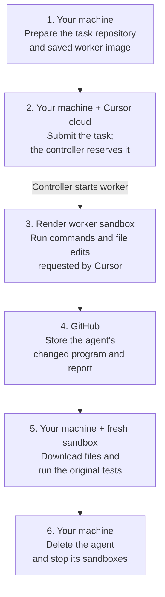

# Run Cursor Cloud Agents in Render Sandboxes

Run a [Cursor Cloud Agent](https://cursor.com/docs/cloud-agent)'s commands and file edits in a temporary [Render Sandbox](https://render.com/docs/sandboxes). Cursor manages the agent in its cloud; Render provides a separate Linux workspace for each task.

This starter asks the agent to fix a JavaScript program that totals three orders as **30 instead of 42**. You retrieve its changes, check them against the original tests in a fresh sandbox, and save the corrected program and report. Choose Python or TypeScript for the local helpers; both run the same JavaScript task.

> This starter is a preview. A complete Cursor task and unattended controller recovery still need validation.

[Run the example](cursor/README.md) · [Prerequisites](#prerequisites) · [Source files](#source-files)

## How it works

Cursor sends tasks to a named group of machines called a [Team Pool](https://cursor.com/docs/cloud-agent/self-hosted/pool). A program on your machine watches the pool and reserves tasks; this is the **controller**. For each task it starts a **worker**, the program that executes Cursor's commands, inside a new Render sandbox.



Two terminals stay open on your machine: one for the controller, one for the task helpers. Worker sandboxes can reach Cursor and GitHub. The separate verification sandbox has outbound networking blocked. The [walkthrough](cursor/README.md) explains setup, expected output, and cleanup in order.

## Prerequisites

- A **Cursor Enterprise team** with [Team Pools](https://cursor.com/docs/cloud-agent/self-hosted/pool#prerequisites) enabled. An admin must enable self-hosted machines, GitHub token minting, and private-worker session tokens.
- The [Cursor GitHub App](https://cursor.com/docs/integrations/github) connected to the team and allowed to access the task repository. The submitting user needs access to that repository too.
- A [Render workspace with Sandboxes enabled](https://render.com/docs/sandboxes#1-confirm-access), currently in early access, and its terminal program, the [Render command-line interface (CLI)](https://render.com/docs/cli), version 2.28.0 or later.
- Python 3.10 or later for **both** paths, because the shared controller uses it. The TypeScript path also needs Node.js 22 or later to run its helpers, and npm to install their packages.
- Bash or zsh, Git, and the [GitHub CLI](https://cli.github.com/), signed in with `gh auth login`. The walkthrough installs the [Cursor CLI](https://cursor.com/docs/cli/installation).

Prepare these two credentials from the **same team**. They let programs use Cursor's application programming interface (API):

| Credential and creation page | Purpose | Where it stays |
| --- | --- | --- |
| [Service account key](https://cursor.com/docs/account/enterprise/service-accounts) | Register the pool, reserve tasks, and obtain worker tokens | First terminal, as `CURSOR_API_KEY`; `CURSOR_RELEASE_API_KEY` uses the same value for failed-start cleanup |
| [User API key](https://cursor.com/docs/cloud-agent/api/overview) | Submit the task, read its status, and delete the agent | Second terminal, as `CURSOR_USER_API_KEY` |

The controller needs the service account key; `agent login` does not supply it. The sandbox receives only a token for its reserved task, never either API key. Render uses `render login` and your selected workspace for this local walkthrough. A controller hosted on a server instead needs a [Render API key](https://render.com/docs/api#1-create-an-api-key).

## Get started

In a terminal, download the starter and enter the repository. If you use zsh, first run `setopt interactivecomments` so pasted lines beginning with `#` are treated as explanations:

```shell
# Download the example and its helper programs from GitHub.
git clone https://github.com/render-examples/cursor-cloud-agents-sandboxes.git
# Enter the downloaded folder before opening the walkthrough.
cd cursor-cloud-agents-sandboxes
```

Follow the [step-by-step walkthrough](cursor/README.md#1-set-up-the-starter). It creates a private task repository, prepares a saved worker image, and runs the controller. Both language paths cover submission, independent verification, and cleanup.

A successful result must pass all four original tests and produce:

```json
{"total":42,"row_count":3}
```

The helpers save `results/total.mjs` and `results/report.json` inside your chosen `cursor/python` or `cursor/typescript` directory. Keep these downloaded files before cleanup deletes the agent and stops its sandboxes. The [cleanup steps](cursor/README.md#7-clean-up) also explain how to remove the saved image and optional test repository.

## Source files

| Files | Purpose |
| --- | --- |
| [Snapshot builder](cursor/controller/build-snapshot.sh) and [spawn script](cursor/controller/spawn.sh) | Save the installed worker tools and start one sandbox per reserved task |
| [Python helpers](cursor/python) and [TypeScript helpers](cursor/typescript) | Submit the task, retrieve and verify its output, and clean up |
| [Sample program](fixture/total.mjs), [input](fixture/orders.csv), and [tests](fixture/test_total.mjs) | The deliberately broken program and the original checks |
| [Prompt](prompt.txt), [task note](cursor/task-note.txt), and [verifier](verify.mjs) | Instructions for the agent and a separate check of its report |

For failures, start with [troubleshooting](cursor/README.md#troubleshooting). For a controller that stays available after your laptop disconnects, see [running the controller on Render](cursor/README.md#run-the-controller-on-render), including the recovery work still needed.
