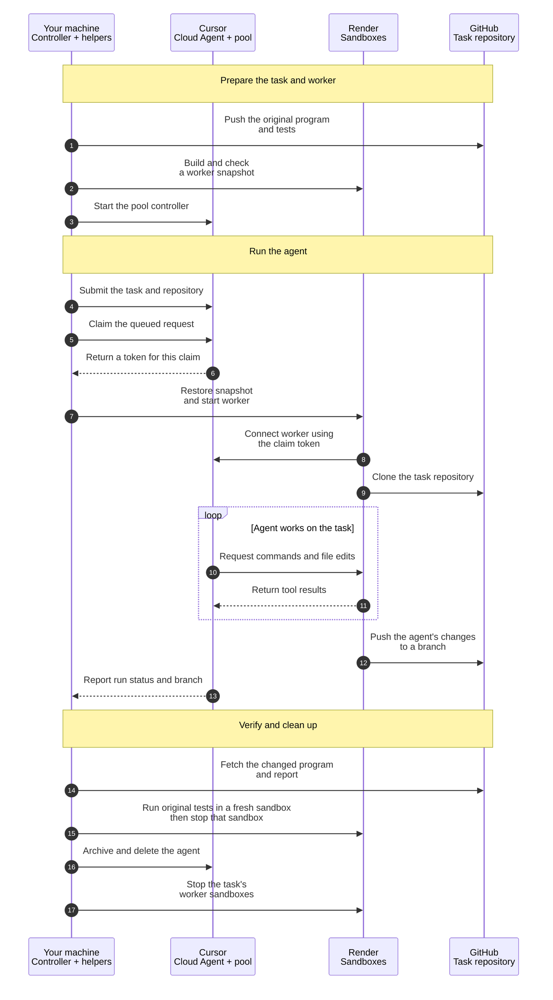

# Cursor Cloud Agents in Render Sandboxes

When an agent modifies code, it needs a workspace to run the program and test its changes. A Render sandbox gives each task an isolated, temporary Linux environment that you can discard when the work is done.

[Cursor Cloud Agents](https://cursor.com/docs/cloud-agent) work on repositories and return changes on a Git branch. A [Team Pool](https://cursor.com/docs/cloud-agent/self-hosted/pool) routes their tool calls to workers you provide. In this guide, Cursor runs the agent, and [Render Sandboxes](https://render.com/docs/sandboxes) host the workers that execute its commands and file operations.

You ask the agent to fix a JavaScript program that skips the last amount in a CSV file, returning **30 instead of 42**. Then you fetch its branch, run the original tests in a fresh sandbox, and save the corrected program and report. Choose TypeScript or Python for the local helpers; both use the same JavaScript task.

> This draft's Render snapshot and verification steps have been tested. A complete Cursor agent run still needs validation with Team Pool credentials. This repository is a reference starter; validate the full provider flow before relying on it for unattended workloads.

## How it works

`agent worker controller` is a command in the Cursor CLI that watches a pool for work. After reserving a request (a *claim*), it runs `controller/spawn.sh`. This script creates a Render sandbox and starts a Cursor worker inside it. The worker connects to Cursor and executes the agent's tool calls.



The controller and helpers run in two terminals on your machine. Both execution and verification happen in Render's cloud. The worker sandbox needs outbound access to Cursor and GitHub; the verification sandbox runs the downloaded files with outbound access blocked. You can later move the controller to a [Render background worker](#run-the-controller-on-render).

## Prerequisites

- A Render workspace with [Sandboxes](https://render.com/docs/sandboxes) enabled and [Render CLI](https://render.com/docs/cli) 2.28.0 or later. These steps use `render login`; unattended controllers need a [Render API key](https://render.com/docs/api#1-create-an-api-key) as `RENDER_API_KEY` instead.
- Python 3.10 or later for the shared controller scripts, including the TypeScript path. TypeScript also needs Node.js 22 or later. Both paths use Bash, Git, and the [GitHub CLI](https://cli.github.com/), authenticated with `gh auth login`.
- A Cursor Enterprise team with **Allow Self-Hosted Machines**, GitHub token minting, and private-worker session tokens enabled. A team admin configures these in the [Cloud Agents dashboard](https://cursor.com/dashboard?tab=cloud-agents). See [Team Pool requirements](https://cursor.com/docs/cloud-agent/self-hosted/pool#prerequisites).
- The [Cursor GitHub App](https://cursor.com/docs/integrations/github) connected at team level and allowed to access the task repository created in step 2.

Use these two Cursor credentials from the same team:

| Credential | Used for | Where to create it | Location |
| --- | --- | --- | --- |
| [Service account API key](https://cursor.com/docs/account/enterprise/service-accounts) | Pool registration, claims, and worker session tokens | Dashboard > Settings > API Keys > Service Accounts | First terminal, as `CURSOR_API_KEY` |
| [User API key](https://cursor.com/docs/cloud-agent/api/overview) | Submitting the task, checking its run, and deleting the agent | Dashboard > API Keys | Second terminal, as `CURSOR_USER_API_KEY` |

Pool workers require a service account key or a token minted from it. An interactive `agent login` does not authenticate the controller. Neither API key enters a sandbox: the controller passes a [session token](https://cursor.com/docs/cloud-agent/self-hosted/pool#session-tokens) that serves only the claimed request. The user who submits the task must have access to its GitHub repository.

## 1. Set up the starter

Clone the starter and enter its `cursor` directory. Run the remaining setup commands there:

```shell
git clone https://github.com/render-examples/cursor-cloud-agents-sandboxes.git
cd cursor-cloud-agents-sandboxes/cursor
```

The commands work in Bash or zsh; controller scripts run with Bash automatically.

```shell
umask 077
render login
render workspace set '<your-workspace-id>'
```

`umask 077` restricts access to files created from this shell and prints no output. `render login` authenticates the CLI; selecting a workspace determines where it creates sandboxes.

Install the [Cursor CLI](https://cursor.com/docs/cli/installation) and confirm it supports the controller options used here:

```shell
curl https://cursor.com/install -fsS | bash
export PATH="$HOME/.local/bin:$PATH"
agent worker controller --help | grep -e '--spawn' -e '--session-token'
```

Install the helpers for your language:

### TypeScript

```shell
(cd typescript && npm ci)
```

### Python

The Python helpers use only the standard library. There is nothing to install.

The starter includes these files. Paths are relative to the `cursor` directory:

| File | Purpose |
| --- | --- |
| `../fixture/` | CSV, broken JavaScript program, and original tests |
| `../prompt.txt` and `task-note.txt` | Agent task and instructions for Cursor's repository checkout |
| `controller/build-snapshot.sh` and `controller/spawn.sh` | Prepare the worker image and start a sandbox for each claim |
| `typescript/` or `python/` | Task submission, verification, and cleanup helpers |

## 2. Put the task in a GitHub repository

Cursor agents work on repositories, so publish the fixture as a private repository:

```shell
export GITHUB_REPO='<your-github-user-or-org>/render-cursor-task'
cp -R ../fixture task-repo
cd task-repo
git init -q -b main
git add .
git commit -qm "Add order total task"
gh repo create "$GITHUB_REPO" --private --source . --remote origin --push
cd ..
export TASK_REPO_URL="https://github.com/$GITHUB_REPO"
```

If the Cursor GitHub App has access only to selected repositories, add this one now.

## 3. Build the worker snapshot

A filesystem snapshot saves the installed Cursor CLI so each new worker can start without reinstalling it:

```shell
./controller/build-snapshot.sh
```

The script installs the CLI in a temporary sandbox, saves a filesystem snapshot, and checks that a sandbox restored from it can run `agent`, `git`, and `node`. It attempts to stop both sandboxes. An excerpt from a recorded Render run is shown below; IDs vary:

```text
building in sbx-...
checking restore in sbx-...
2026.10.01-e373342
git version 2.39.5
v24.14.1
worker snapshot ready
export WORKER_SNAPSHOT_ID='snp-...'
```

Run the printed `export` line in this terminal. CLI and runtime versions can differ because the script installs the current Cursor release.

> If creation times out, check the [Render Dashboard](https://dashboard.render.com/) before retrying to avoid creating duplicate resources. Keep any returned sandbox and snapshot IDs for [cleanup](#7-clean-up), including after a failure.

## 4. Start the controller

In the first terminal, enter the service account key at the hidden prompt. Typing displays no characters; paste the key and press Enter. Start the controller and leave it running:

```shell
printf 'Cursor service account key: '
read -rs CURSOR_API_KEY
printf '\n'
export CURSOR_API_KEY CURSOR_RELEASE_API_KEY="$CURSOR_API_KEY"
agent worker controller \
  --spawn "$PWD/controller/spawn.sh" \
  --pool render-sandboxes \
  --session-token
```

`CURSOR_RELEASE_API_KEY` is a second name for the same service account key, used by the hook if startup fails. The controller registers the `render-sandboxes` pool and waits for requests; it does not start the sample task yet. For each claimed request, `controller/spawn.sh`:

1. Creates a sandbox from `WORKER_SNAPSHOT_ID`, passing the claim's session token in its environment.
2. Writes the token to `/run/cursor/token` and starts `agent worker --pool render-sandboxes --clone-git-repos --auth-token-file /run/cursor/token`.
3. Records the request ID and sandbox ID in `claims.tsv`.
4. Monitors the worker and requests termination after three consecutive failed checks. The worker stays available for follow-ups for 600 seconds after a session ends. The sandbox has a separate two-hour maximum lifetime.

If startup fails, the hook attempts to stop the sandbox and release the claim with `CURSOR_RELEASE_API_KEY`. Check the recorded sandbox and claim if either cleanup request fails. Worker sandboxes use the `allow-all` network policy because the worker connects out to Cursor and GitHub.

The spawn hook is a Bash script for both language tabs because the controller runs it as a program. You can replace it with an executable in any language.

## 5. Send the task

Open a second terminal in the same `cursor` directory. Read the user key, then send the task:

### TypeScript

```shell
umask 077
cd typescript
export TASK_REPO_URL='https://github.com/<your-github-user-or-org>/render-cursor-task'
printf 'Cursor user API key: '
read -rs CURSOR_USER_API_KEY
printf '\n'
export CURSOR_USER_API_KEY
npx tsx run_task.ts
```

### Python

```shell
umask 077
cd python
export TASK_REPO_URL='https://github.com/<your-github-user-or-org>/render-cursor-task'
printf 'Cursor user API key: '
read -rs CURSOR_USER_API_KEY
printf '\n'
export CURSOR_USER_API_KEY
python3 run_task.py
```

The helper creates an agent in the `render-sandboxes` pool for your repository's `main` branch. It prints the agent's Cursor URL, where you can follow the run. The controller terminal prints `sandbox sbx-... for bc-...` after creating the sandbox, before it checks readiness. That message alone does not confirm the worker connected.

The helper checks the run every 10 seconds for up to 30 minutes and saves `agent.json` and `run.json`. On the success path, the helper is written to print the following. This Cursor completion output has not yet been observed in a live run of this starter:

```text
Run status: FINISHED
Pushed branch: cursor/...
```

> A local timeout does not cancel the Cursor run. If you stop here, keep `agent.json` and run [cleanup](#7-clean-up). Continue to verification only after the helper reports a finished run and a pushed branch.

## 6. Verify and retrieve the result

Check the agent's work independently of its reply:

### TypeScript

```shell
npx tsx verify_result.ts
```

### Python

```shell
python3 verify_result.py
```

The helper fetches the pushed branch into `../task-repo` and saves its `total.mjs` and `outputs/report.json` in `results`. It then starts a new sandbox with the `deny-all` network policy. It copies in the original `orders.csv`, `test_total.mjs`, and `verify.mjs` with the branch's two files, and runs the tests and the check. It stops that sandbox before exiting.

The verification helpers passed all four tests against a manually corrected branch in real Render sandboxes. They produced this output (IDs abbreviated). This validates the verification step, not a Cursor-generated fix:

```text
Verified report: total=42, row_count=3
Verification sandbox sbx-... is terminated.
```

If the branch changed the CSV or the tests, the helper says so, and the check still uses the originals. View the retrieved report:

```shell
cat results/report.json
```

```json
{"total":42,"row_count":3}
```

`results/total.mjs` is the corrected program. Both files stay after cleanup.

## 7. Clean up

A finished run can leave its worker available for follow-up tasks. Cleanup ends the Cursor agent and stops its sandbox to release the compute resources. Stopping a sandbox destroys its filesystem; keep the retrieved files in `results` before proceeding.

Stop the controller in the **first terminal** with **Ctrl+C** so it cannot accept more requests. Then, in the **second terminal**, delete the agent and stop its recorded worker sandboxes:

### TypeScript

```shell
npx tsx cleanup.ts
```

### Python

```shell
python3 cleanup.py
```

The helper archives and deletes the agent, which ends its claim. It then stops each sandbox recorded for that agent in `claims.tsv` and confirms each has ended (`terminated` or `errored`). A timeout can leave a sandbox `errored` even after a successful stop request; this does not mean the agent completed its task. It attempts every step and exits with an error if any step fails.

In the **second terminal**, clear the user key after cleanup succeeds:

```shell
unset CURSOR_USER_API_KEY
```

In the **first terminal**, remove the snapshot when you no longer need it and clear the controller keys:

```shell
render ea sandboxes snapshots delete "$WORKER_SNAPSHOT_ID" --confirm
render ea sandboxes list --all
unset CURSOR_API_KEY CURSOR_RELEASE_API_KEY
```

Check the IDs in `claims.tsv` against the listing. Your test sandboxes should be `terminated`, or `errored` after a timeout; other workloads in the workspace may still be running. Retain `agent.json` and `claims.tsv` if cleanup fails so you can retry. `unset` prints no output and does not revoke the keys.

The task repository contains the original and agent-created branches. Keep it to inspect the fix, or delete it from the first terminal if you no longer need it:

```shell
gh repo delete "$GITHUB_REPO" --yes
```

Deletion removes the remote repository and its branches. If GitHub refuses it because the token lacks `delete_repo`, use `gh auth refresh -s delete_repo`. Local files in `results` remain. The pool also stays registered; remove it with Cursor's [pools API](https://cursor.com/docs/cloud-agent/self-hosted/pool#manage-pools) when no longer needed.

## Troubleshooting

| Problem | Check |
| --- | --- |
| `--spawn` or `--session-token` is missing | Run `agent update`, then check `agent worker controller --help` again. |
| The controller exits or rejects its key | `CURSOR_API_KEY` must be a service account key, and the team must have self-hosted workers and session tokens enabled. |
| The run stays queued | The controller is running and shows no `spawn failed` line. **Allow Self-Hosted Machines** is on. |
| `spawn failed: worker exited during startup` | The worker could not authenticate with its session token. The hook attempts to stop the sandbox and release the claim; confirm both before retrying. Check the team's session token setting and the service account. |
| The run stays queued after `sandbox sbx-...` appears | A failed clone leaves the run queued. Confirm GitHub token minting is on, and that the Cursor GitHub App and the user who started the run can access the repository. |
| The run finishes without a branch | Open the agent's URL to see what it did. Run cleanup, then send the task again. |
| Verification fails | Inspect `results/total.mjs` and `results/report.json`. A finished run alone does not establish success. |
| Sandboxes are still running after cleanup | Their requests were not in `agent.json`. Match the IDs in `claims.tsv` to `render ea sandboxes list --all`, then stop only the sandboxes belonging to this test. |

## Run the controller on Render

To keep the pool available without your terminal, run the same controller command in a Render [background worker](https://render.com/docs/background-workers). Its image needs Bash, Python 3.10 or later, the Render CLI, the Cursor CLI, and `controller/spawn.sh`. Set `CURSOR_API_KEY`, `CURSOR_RELEASE_API_KEY`, `WORKER_SNAPSHOT_ID`, and `RENDER_API_KEY` as secret environment variables. Run one instance.

Each sandbox's stop monitor is a process on the controller host. A failed check can mean either worker exit or a failed connection; production monitoring should distinguish them. Persist claim-to-sandbox records across restarts, reconcile orphaned sandboxes, and refresh expired snapshots before relying on an unattended controller. After a redeploy, list running sandboxes and stop finished ones. Use a sandbox only for workers, not for the controller: a sandbox lives at most 24 hours. See [Sandboxes](https://render.com/docs/sandboxes) for current limits and Cursor's [controller reference](https://cursor.com/docs/cloud-agent/self-hosted/pool) for warm pools, hibernation, and claim release.

## Source files

- [Worker snapshot](cursor/controller/build-snapshot.sh) and [spawn hook](cursor/controller/spawn.sh)
- [Python helpers](cursor/python) and [TypeScript helpers](cursor/typescript)
- [Original program](fixture/total.mjs), [tests](fixture/test_total.mjs), and [CSV](fixture/orders.csv)
- [Agent prompt](prompt.txt), [Cursor task note](cursor/task-note.txt), and [report verification](verify.mjs)

## Development checks

From the repository root:

```shell
python3 -m venv .venv
source .venv/bin/activate
python -m pip install -r requirements-dev.txt
npm ci --prefix cursor/typescript
npm run check --prefix cursor/typescript
python -m pytest -q
```

The 24 local contract tests use a fake Cursor API, a fake Render CLI, and local Git
repositories. They cover both languages' task submission, status handling, independent
verification, and cleanup failures. They do not run a real Cursor agent or create cloud resources.
The fixture is intentionally broken: running its tests directly should fail until repaired.

## Validation status

On October 8, 2026, the helpers passed 24 local contract tests and TypeScript/Python
syntax checks. Earlier real Render checks covered snapshot creation and restoration,
worker rejection of an invalid token, and verification of manually prepared good and
bad branches. Those checks did not establish a real Cursor-generated fix.

A complete Team Pool run still requires a service account key and user API key with
the documented team settings. Unattended controller recovery and claim reconciliation
also need validation. This repository's publication does not close those gaps.
